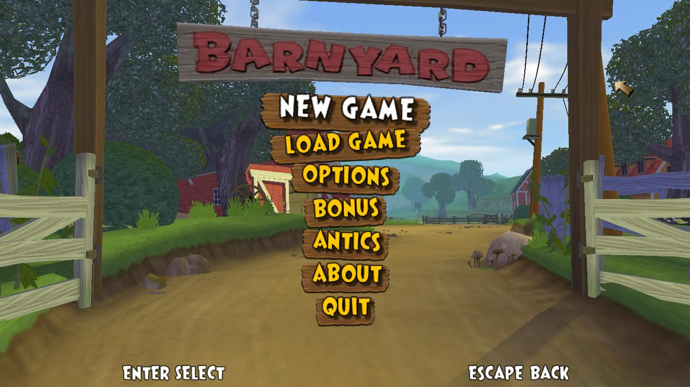
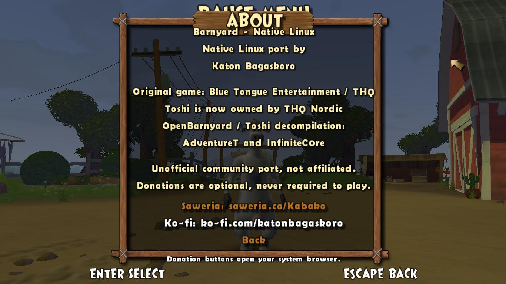

# Barnyard Linux

**Port komunitas native Linux tidak resmi untuk Barnyard, oleh Katon Bagaskoro.**

[English](README.md) · [Bahasa Indonesia](README.id.md) · [Instalasi](#instalasi) · [Lisensi](LICENSE.md) · [Build](docs/BUILD.md)

Runtime game native i386, dikemas sebagai `.deb` amd64 untuk **Linux Mint 22.x / Ubuntu 24.04**. Tanpa Wine, DLL Windows, atau emulator. Kamu harus menyediakan data game PC yang dimiliki secara sah.

> **Penting soal lisensi:** repositori ini memakai beberapa lisensi, **bukan seluruhnya GPL**. Kode turunan OpenBarnyard/Toshi tetap memakai lisensi upstream non-komersial; launcher Python independen tetap MIT. GPL-3.0-only hanya berlaku untuk skrip publikasi GitHub independen yang baru. Baca [LICENSE.md](LICENSE.md) sebelum menyalin, mendistribusikan, atau melakukan monetisasi. Ini bukan produk resmi dan tidak menyiratkan dukungan pemilik game.

## Screenshot

Screenshot asli dari pengguna; hak artwork game tetap pada pemiliknya. Gambar ini untuk dokumentasi, bukan data yang dapat dipakai menjalankan game. Logo judul asli di dalam game tidak diubah.

### Menu utama



### Tentang dan kredit



## Fitur

- Runtime native SDL2/OpenGL; langsung main dari menu aplikasi.
- Ikon aplikasi Barnyard + Linux/penguin, terpisah dari logo asli di dalam game.
- Pilih folder game milik sendiri sekali; launcher mengingat lokasinya.
- Pengaturan fullscreen/jendela, teks English/Indonesia, dan tangkapan mouse tersimpan.
- Penghitung FPS opsional di Pengaturan menu awal maupun pause; langsung berlaku, tersimpan otomatis, default nonaktif. Tidak mengubah VSync atau pembatas FPS.
- **Alt+Enter:** ganti fullscreen/jendela. **Shift+F1:** lepas/kunci kembali mouse. Kehilangan fokus melepas tangkapan mouse.
- Halaman About mempertahankan kredit asli/upstream dan mencantumkan **Katon Bagaskoro** sebagai pembuat port Linux.
- Peluncuran langsung, pemilih folder, serta mode diagnostik/log.

Terjemahan Indonesia masih draf mesin dengan perbaikan istilah, bukan lokalisasi resmi yang sudah diperiksa manusia sepenuhnya. Suara asli dan aset dasar English UK tidak diubah. Sebagian HUD yang di-cache mungkin membutuhkan restart setelah ganti bahasa.

## Spesifikasi minimum

**Perkiraan acuan, bukan batas hardware yang sudah diukur.** Kebutuhan GPU/API dan arsitektur OS berasal dari runtime/paket; angka CPU, RAM, dan ruang kosong di bawah adalah perkiraan awal konservatif, bukan minimum hasil benchmark atau janji 60 FPS.

| Komponen | Minimum / perkiraan awal |
| --- | --- |
| OS | Linux Mint 22.x atau Ubuntu 24.04 **64-bit amd64**, dengan multiarch i386 aktif |
| CPU | Prosesor x86-64 yang dapat menjalankan aplikasi x86 32-bit; dual-core sekitar 2 GHz sebagai saran awal yang belum divalidasi |
| RAM | Disarankan 4 GB RAM sistem; pemakaian aktual game/desktop belum diprofilkan |
| Grafis | GPU dan driver Linux dengan dukungan **OpenGL 3.3 core profile**; hardware yang hanya mendukung OpenGL lebih lama tidak cukup |
| Layar | Desktop X11; jendela awal game 800 × 600. Resolusi lain bergantung layar/driver |
| Penyimpanan | Data PC game lengkap milik sendiri, ditambah sekitar 1 GB ruang kosong untuk dependensi paket, save, dan log; ukuran unduhan/instalasi dependensi sebenarnya bisa berbeda |
| Input | Keyboard dan mouse |
| Data game | Data PC Barnyard lengkap yang diperoleh secara sah; tidak dibundel atau diunduh oleh proyek ini |

### Perangkat acuan yang diuji pengguna

**ThinkPad X270 — Intel Core i7-7600U, Intel HD Graphics 620, RAM 8 GB, Linux Mint 22.3 Xfce/X11.** Pengguna melaporkan permainan lancar sekitar **60 FPS** pada perangkat ini. Ini acuan laporan pengguna, bukan spesifikasi minimum, benchmark otomatis, atau jaminan untuk perangkat lain. GPU lain, Wayland, dan distro lain belum disertifikasi secara independen.

## Instalasi

Unduh `barnyard-linux_1.0.0_amd64.deb` dari [Releases](https://github.com/Katon17/barnyard-linux/releases) **setelah rilis diterbitkan**. Draft atau rilis privat hanya terlihat bagi pengguna yang berhak; tautan ini bukan klaim bahwa unduhan publik sudah tersedia.

Jika i386 belum diaktifkan:

```bash
sudo dpkg --add-architecture i386
sudo apt update
```

Tutup game. Jika paket `.deb` tersimpan di Downloads:

```bash
sudo apt install "$HOME/Downloads/barnyard-linux_1.0.0_amd64.deb"
```

APT memasang dependensi dan mengganti paket `barnyard-linux-test`/preview lama. Tidak perlu menghapus save. Buka **Barnyard Linux** dari menu aplikasi, lalu pilih folder yang berisi `Data` jika diminta. **Jangan menjalankan game dengan sudo/root.**

Jika pin panel Xfce masih memakai ikon lama, lepaskan pin itu lalu pin ulang Barnyard Linux dari menu. Paket tidak mengedit pengaturan panel pribadimu.

### Checksum paket

Versi 1.0.0, `barnyard-linux_1.0.0_amd64.deb` (3.449.332 byte):

```text
272caef36c8bc9a8c8e06573b8995bb6858f8d334202097f579a41096bc5f5dc
```

```bash
sha256sum "$HOME/Downloads/barnyard-linux_1.0.0_amd64.deb"
```

## Save, pengaturan, dan log

Folder internal lama sengaja dipertahankan agar pergantian nama paket tidak membuat progres lama tidak terbaca:

| Kegunaan | Lokasi jika tidak ditimpa pengaturan XDG |
| --- | --- |
| Save dan preferensi native | `~/.local/share/barnyard-linux-test/` |
| Lokasi game yang diingat | `~/.config/barnyard-linux-test/launcher.json` |
| Log diagnostik baru, izin privat | `~/Downloads/barnyard-*.txt` |

Nama folder `test` hanya namespace kompatibilitas, bukan nama aplikasi sekarang. Jangan menggantinya sendiri. Upgrade tidak mengimpor atau menghapus save. Backup tetap disarankan. Uninstall juga tidak menghapus save/pengaturan pribadi.

Log bisa berisi username dan path lokal: periksa/samarkan sebelum dibagikan. Jangan unggah aset game, save pribadi, atau kredensial.

```bash
barnyard-linux --version
barnyard-linux --choose-folder
barnyard-linux --diagnostic
barnyard-linux --runtime-help
```

Perintah `barnyard-linux-test` lama hanya alias kompatibilitas; tidak ada entri aplikasi kedua.

## Status dan bukti pengujian

- **1.0.0** adalah rilis branding komunitas berdasarkan gameplay yang disetujui pengguna. Pengguna melaporkan permainan lancar sekitar **60 FPS**; ini bukan benchmark otomatis. Pengguna menjelaskan FPS screenshot yang lebih rendah sebagai dampak pengambilan screenshot.
- Build bersih: **1.103 / 1.103** unit source berhasil dikompilasi, tanpa kegagalan, dan link berhasil.
- **22 patch / 122 file upstream yang dimodifikasi** berhasil direkonstruksi byte-identik terhadap revisi upstream yang dikunci.
- Uji otomatis mencakup komponen SDL/OpenGL/input/fokus/fullscreen, tampilan/toggle FPS, persistensi preferensi, properti ikon/WM_CLASS X11 nyata, dan launcher/diagnostik terpasang.
- Upgrade APT dari test6 mempertahankan tiga file fixture lama byte-identik, termasuk preferensi FPS aktif. Sentinel save palsu hanya fixture migrasi, **bukan** bukti save/reload game sungguhan.
- Belum ada sertifikasi independen untuk semua misi, siklus save, cutscene, perangkat audio, GPU, atau desktop. Tidak ada garansi atau janji performa universal.

Lihat [pengujian dan batasan](docs/TESTING.md), [catatan perubahan](CHANGELOG.md), dan bukti terpilih di `reports/`. Log mentah dan path mesin pribadi tidak diunggah sembarangan.

## Untuk pengembang

Upstream yang dikunci: [InfiniteC0re/OpenBarnyard](https://github.com/InfiniteC0re/OpenBarnyard), commit `b63d5e320c428627ac0027381cd84d3bd4c1f3a7`.

Repo memuat adaptasi Linux, seri patch berurutan, launcher, packaging, pengujian, dan ikon fan-made asli. Source upstream diambil terpisah dengan sparse checkout; aset proprietary dan payload SDK biner upstream tidak dibundel.

Lihat [BUILD.md](docs/BUILD.md), [CONTRIBUTING.md](CONTRIBUTING.md), [SECURITY.md](SECURITY.md), dan [petunjuk publikasi](docs/PUBLISH.md). Kompilasi hanya untuk pengembang; pemain cukup memasang `.deb`.

## Kredit, donasi, dan lisensi

- **Port Linux:** Katon Bagaskoro ([Katon17](https://github.com/Katon17)).
- **Game asli:** Blue Tongue Entertainment / THQ; Toshi kini dimiliki THQ Nordic.
- **Dekompilasi OpenBarnyard / Toshi:** AdventureT dan InfiniteC0re.
- Baca [peta lisensi dan atribusi](LICENSE.md) serta pemberitahuan di `third_party/`.

Screenshot/runtime About memuat tombol Saweria dan Ko-fi opsional. Browser hanya terbuka setelah tombol diklik; donasi tidak pernah diwajibkan untuk bermain. **Keberadaan tombol bukan izin monetisasi proyek upstream.** Upstream melarang penggunaan komersial (“any sort of profit”); izin distribusi publik yang dikaitkan donasi **belum ditetapkan**. Skrip publikasi yang disediakan membuat **repositori privat dan draft release**, bukan kampanye donasi publik. Tinjau hak dan minta kejelasan sebelum distribusi publik dengan tautan tersebut. Distribusi privat pun tidak otomatis menyelesaikan semua persoalan hak.

---

**English:** full English documentation is available in [README.md](README.md). This unofficial port requires owned game data. The upstream non-commercial license remains binding; GPL-3.0 covers only the new independent publication helper, not the entire project.
