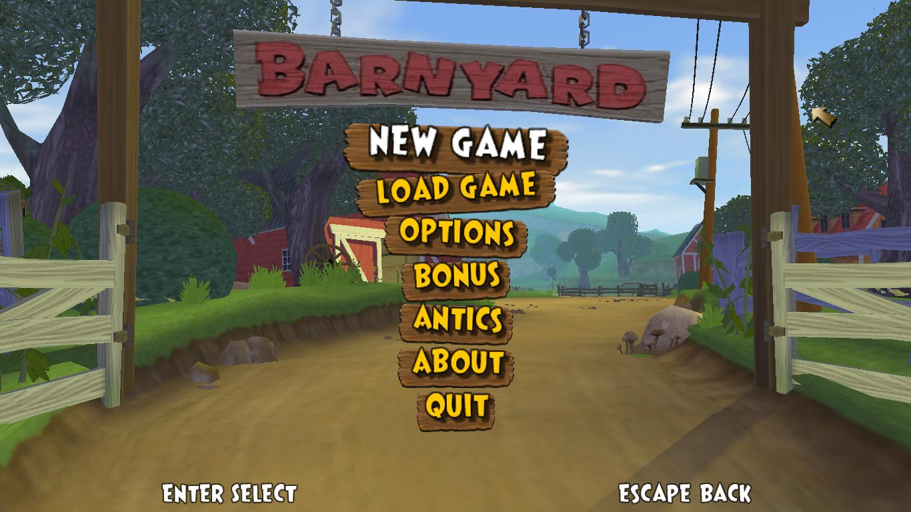
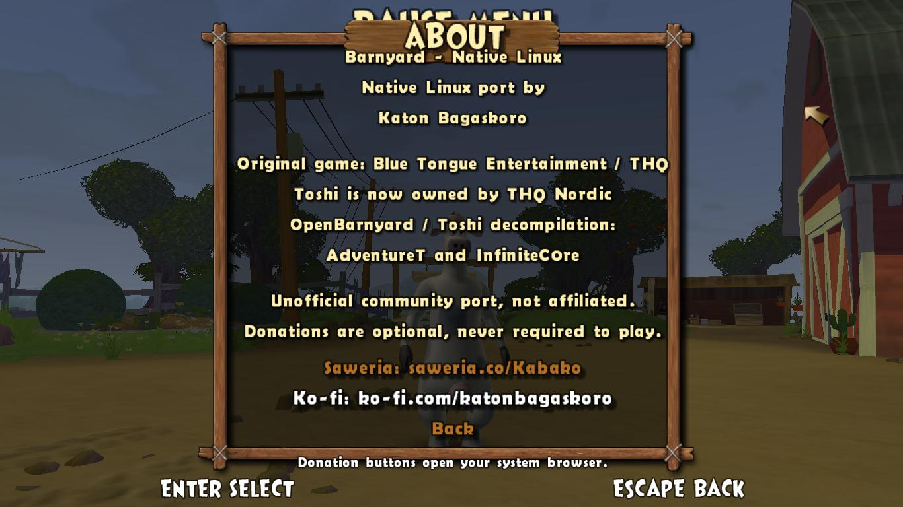

# Barnyard Linux

**An unofficial native Linux community port of Barnyard, by Katon Bagaskoro.**

[English](README.md) · [Bahasa Indonesia](README.id.md) · [Install](#installation) · [License](LICENSE.md) · [Build](docs/BUILD.md)

Native i386 game runtime, packaged as an amd64 `.deb` for **Linux Mint 22.x / Ubuntu 24.04**. No Wine, Windows DLLs or emulator. You must supply your own legally obtained PC game data.

> **Licensing matters:** this is a mixed-license project, **not a GPL-licensed game**. The OpenBarnyard/Toshi-derived code retains its upstream non-commercial license; the independent Python launcher retains MIT. Only the new, independent GitHub publication helper is GPL-3.0-only. Read [LICENSE.md](LICENSE.md) before copying, distributing or monetizing. This is not an official product and does not imply endorsement.

## Screenshots

Actual user-supplied screenshots; game artwork belongs to its respective owners. These are documentation images, not game data to run the port. The original in-game title artwork is unchanged.

### Main menu



### About and credits



## Features

- Native SDL2/OpenGL runtime; launch directly from the application menu.
- Barnyard + Linux/penguin application icon, separate from the original in-game logo.
- Choose the owned game folder once; the launcher remembers it.
- Persistent fullscreen/windowed, English/Indonesian text and mouse-capture preferences.
- Optional FPS counter in main-menu and pause Options; applied immediately, saved automatically, off by default. It does **not** alter VSync or frame limits.
- **Alt+Enter:** toggle fullscreen. **Shift+F1:** release/recapture the mouse. Losing focus releases capture.
- About screen retains original/upstream credits and credits the Linux port to **Katon Bagaskoro**.
- Direct launcher, folder chooser and diagnostic/log mode.

Indonesian text is a machine-translation draft with curated terminology, not a fully human-reviewed official localization. Voices and original English UK backing assets are unchanged. Some cached HUD text may require restarting after a language change.

## Minimum specifications

**Planning estimates, not a measured hardware cutoff.** The GPU/API and OS architecture requirements come from the runtime/package; CPU, RAM and spare-storage figures below are conservative starting estimates, not benchmark-validated minimums or a 60 FPS promise.

| Component | Minimum / starting estimate |
| --- | --- |
| OS | Linux Mint 22.x or Ubuntu 24.04 **64-bit amd64**, with i386 multiarch enabled |
| CPU | x86-64 processor able to execute 32-bit x86 applications; dual-core around 2 GHz suggested as an unvalidated starting point |
| RAM | 4 GB system RAM suggested; actual game/desktop usage has not been profiled |
| Graphics | GPU and Linux driver supporting **OpenGL 3.3 core profile**; older OpenGL-only hardware is insufficient |
| Display | X11 desktop; 800 × 600 initial game window. Other resolutions depend on the display/driver |
| Storage | Complete owned PC game data, plus approximately 1 GB spare for package dependencies, saves and logs; actual dependency download/installed size varies |
| Input | Keyboard and mouse |
| Game data | Complete, legally obtained PC Barnyard data; not bundled or downloaded by this project |

### User-tested reference hardware

**ThinkPad X270 — Intel Core i7-7600U, Intel HD Graphics 620, 8 GB RAM, Linux Mint 22.3 Xfce/X11.** The user reported smooth play around **60 FPS** on this setup. This is a reference report, not the minimum specification, an automated benchmark or a guarantee for other hardware. Other GPUs, Wayland and other distributions are not independently certified.

## Installation

Download `barnyard-linux_1.0.0_amd64.deb` from [Releases](https://github.com/Katon17/barnyard-linux/releases) **when a release is published**. A draft/private release is visible only to authorized users; this link is not a claim that a public download already exists.

If i386 is not enabled:

```bash
sudo dpkg --add-architecture i386
sudo apt update
```

Close the game. With the `.deb` in Downloads:

```bash
sudo apt install "$HOME/Downloads/barnyard-linux_1.0.0_amd64.deb"
```

APT installs dependencies and replaces the old `barnyard-linux-test`/preview package. Do not manually delete your saves. Open **Barnyard Linux** from the application menu and choose the folder containing `Data` if prompted. Do **not** run the game as root.

If an old Xfce panel pin still shows the previous icon, remove that pin and pin Barnyard Linux again. The package does not modify your personal panel settings.

### Package checksum

Version 1.0.0, `barnyard-linux_1.0.0_amd64.deb` (3,449,332 bytes):

```text
272caef36c8bc9a8c8e06573b8995bb6858f8d334202097f579a41096bc5f5dc
```

```bash
sha256sum "$HOME/Downloads/barnyard-linux_1.0.0_amd64.deb"
```

## Saves, settings and logs

The old internal directories are deliberately retained so the package rename does not hide your progress:

| Purpose | Path (unless XDG overrides it) |
| --- | --- |
| Saves and native preferences | `~/.local/share/barnyard-linux-test/` |
| Remembered game folder | `~/.config/barnyard-linux-test/launcher.json` |
| New private diagnostic logs | `~/Downloads/barnyard-*.txt` |

The `test` directory name is a compatibility namespace, not the current application name. Do not rename it yourself. The upgrade neither imports nor removes saves. Backups are recommended. Uninstalling does not delete personal saves/configuration.

Logs can contain local usernames and paths: inspect/redact them before sharing. Do not upload game assets, private saves or credentials.

```bash
barnyard-linux --version
barnyard-linux --choose-folder
barnyard-linux --diagnostic
barnyard-linux --runtime-help
```

The old `barnyard-linux-test` command remains only as a compatibility alias; no second desktop entry is installed.

## Status and evidence

- **1.0.0** is the community branding release based on user-approved gameplay. The user reported smooth play around **60 FPS**; this is not an automated benchmark. Lower screenshot FPS was attributed by the user to capture overhead.
- Clean build: **1,103 / 1,103** source units compiled, zero failures, linked successfully.
- **22 patches / 122 modified upstream files** replayed byte-for-byte against the pinned upstream revision.
- Automated checks cover SDL/OpenGL/input/focus/fullscreen components, FPS formatting/toggling, preference persistence, real X11 icon/WM_CLASS properties, and installed direct/diagnostic launchers.
- APT rename upgrade from test6 retained three disposable legacy fixture files byte-for-byte, including FPS-enabled preferences. A fake save sentinel is a migration fixture, **not** evidence of a real game save/reload.
- Not every mission, save cycle, cutscene, audio device, GPU or desktop has been independently certified. No warranty or universal performance promise is made.

See [testing and limitations](docs/TESTING.md), [changelog](CHANGELOG.md) and the curated `reports/` evidence. Build logs and private machine paths are not indiscriminately published.

## Developers

The pinned upstream is [InfiniteC0re/OpenBarnyard](https://github.com/InfiniteC0re/OpenBarnyard), commit `b63d5e320c428627ac0027381cd84d3bd4c1f3a7`.

The repository contains the Linux adaptation, ordered patch series, launcher, packaging, tests and original fan application icon. Upstream source is fetched separately with a sparse checkout; no proprietary assets or upstream binary SDK payloads are vendored here.

See [BUILD.md](docs/BUILD.md), [CONTRIBUTING.md](CONTRIBUTING.md), [SECURITY.md](SECURITY.md) and [publication instructions](docs/PUBLISH.md). Developer compilation is optional; ordinary players should install the `.deb`.

## Credits, donations and licensing

- **Linux port:** Katon Bagaskoro ([Katon17](https://github.com/Katon17)).
- **Original game:** Blue Tongue Entertainment / THQ; Toshi is now owned by THQ Nordic.
- **OpenBarnyard / Toshi decompilation:** AdventureT and InfiniteC0re.
- See the [complete attribution and license map](LICENSE.md) and `third_party/` notices.

The About screenshot/runtime includes optional Saweria and Ko-fi buttons. They open the system browser only after a click and are never required to play. **Their presence is not permission to monetize the upstream project.** The upstream forbids commercial use (“any sort of profit”); permission for donation-linked public distribution has **not** been established. The supplied publication helper creates a **private repository and draft release**, not a public donation campaign. Review rights and obtain clarification before public distribution with those links. We do not claim that private distribution itself resolves all rights questions.

---

**Bahasa Indonesia:** dokumentasi lengkap tersedia di [README.id.md](README.id.md). Port ini tidak resmi, memerlukan data game milik sendiri, dan lisensi upstream non-komersial tetap berlaku. Seluruh proyek **bukan** GPL; GPL-3.0 hanya untuk skrip publikasi independen baru.
